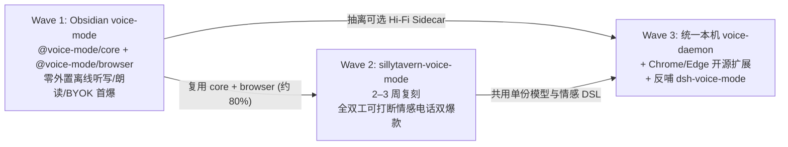

# Obsidian Voice Mode 完整实施规划（Master Plan）

> **阅读说明**：第 1 节保留 2026-11-21 的立项基准；以下各节记录原定目标。M0–M6 的实测结果见[验收记录](../qa/acceptance-checklist.md)，工作进度见[当前状态](../rules/STATE.md)。现阶段仅维护 GitHub 源码。M4 的发布准备已完成，版本发布、目录提审及商店上架均未执行。

---

## 1. 第一性原理与实测基线

将 [`dsh-voice-mode`](https://github.com/qishuilalala/dsh-voice-mode) 沉淀的本地离线语音能力横向复制到开源大众生态，必须同时满足四道硬约束，而非凭直觉或 Star 数立项：

1. **外部依赖安装断崖**：Obsidian 官方社区目录（2026-11-21 实测总计 **10,682 款插件**，且插件 ID **`voice-mode` 空闲可用**）呈现极清晰的对照实验——零外置服务的语音/AI 插件能跑出量级下载（`Copilot` 330 万、`Smart Connections` 120 万、`Whisper` 6 万、`Aloud` 20,134、`Speech Kit` 6,000），而功能贴合中文的 `Local Speech Recognition` 仅因要求用户自行部署 `sherpa-onnx-offline-websocket-server` 滞留在 **181 次下载**，需另装菜单栏 App 的 `Otoha TTS` 仅 **1,000 次下载**。因此首装体验必须**零外部守护进程**。
2. **Electron V8 内存笼与 WASM 内存墙**：Obsidian 桌面端 Installer 与 App 版本独立升级——**Installer 1.14.4 内置 Electron 43.7.5，Installer 1.15.1 已升至 Electron 43.8.9**，两者均启用 V8 Memory Cage 禁止 N-API 返回堆外 `External Buffer`，导致原生 `sherpa-onnx-node`（Kokoro 高速推理）100% 抛出 `External buffers are not allowed`；而在浏览器/渲染进程 WASM 中，`sherpa-onnx` v1.13.7 存在 `kokoro-int8` 缺失 `ConvInteger(10)` 静默输出全零静音缺陷（`k2-fsa/sherpa-onnx#3960`），且三大模型同时常驻 32 位 WASM 堆易冲向 1.8–2.6 GB OOM。
3. **本机真实 WASM 基准（实测数据，非估算）**：
   - 测试环境：Apple Silicon macOS、Node `v24.21.0`、`sherpa-onnx` WASM 14 MB、5 秒中文真实语音片段，采集日期 **2026-11-21**（注：此为接入 Obsidian 前的独立本机基准，Obsidian 桌面 Electron Web Worker 的后续数据见 M0 验收记录）。
   | 引擎 / 模型（WASM） | 冷加载耗时 | RTF（实时率） | 峰值 RSS | 架构含义 |
   | --- | ---: | ---: | ---: | --- |
   | `Silero VAD` | **27 ms** | — | 轻量常驻 | 可随默认档常驻前端 Worker，支撑低延迟端点与打断检测 |
   | `SenseVoice int8` | **696 ms** | **0.258** | **460 MB** | 桌面端单模型离线听写首选（中英混识 + 自动标点 + ITN，快于实时约 3.8 倍） |
   | `Zipformer2`（流式） | **1,939 ms** | **0.259** | **463 MB** | 适合可选流式预览或 `voice-daemon` 常驻；首装不与 SenseVoice 并行双载以防 RSS 破 1 GB |
   | `VITS` | **444 ms** | — | **581 MB** | 可作为桌面端离线朗读可选档，但与 SenseVoice 同进程常驻须实测内存回收与空闲卸载 |
4. **工具链与声学参考基线**：
   - 工具链（锁文件实测）：`obsidian@1.14.4`、`eslint-plugin-obsidianmd@0.6.0`、`esbuild@0.25.12`（`^0.25.0`）、`typescript@5.9.3`（`^5.8.0`）、Node `>= 22.18.0`（三包单测通过原生 type-stripping 直接导入 `.ts`；CI 固定 Node 22 + `pnpm@12.21.0`）。
   - `dsh-voice-mode` 同源桌面 Chromium AEC3 历史参考基线：纯回声误触发 **0 / 937 帧**，打断确认 **252–517 ms**（**注意**：该数值来自 DSH 桌面 Chromium，Obsidian 桌面 Electron 43.7.5 / 43.8.9 内真实表现须在 M0 Spike 与 M2/M3 真机重测，不可直接套用宣称）。

---

## 2. 三波系列化开源矩阵战略

本仓库不是孤立单点插件，而是与 `dsh-voice-mode` 同源的 **Voice Mode 跨平台开源矩阵** 的核心母仓（内部拆为 `@voice-mode/core`、`@voice-mode/browser`、`@voice-mode/obsidian-plugin` 三包）：



| 波次 | 目标产品与仓库 | 战略定位 | 核心复用与协同 |
| --- | --- | --- | --- |
| **Wave 1**（M0–M4） | **`qishuilalala/obsidian-voice-mode`**（插件 ID `voice-mode`） | **口碑与 Star 首爆主战场**：填补 Obsidian 社区“零外置服务 + 中文/中英混说离线听写 + Markdown 表格降噪朗读 + Copilot 侧栏零耦合语音输入”空白 | 在本仓打磨零依赖 `@voice-mode/core` 与 `@voice-mode/browser`，建立完整 CI/安全/声学验收标杆 |
| **Wave 2**（M5，2–3 周连发） | **`sillytavern-voice-mode`** | **垂直高粘性情感语音双爆款**：利用 SillyTavern 无沙箱浏览器 + `STREAM_TOKEN_RECEIVED` / `stopGeneration()`，以全双工 AEC3 打断 + 情感标签 DSL 形成对半双工竞品的体验代差 | 直接复用 `@voice-mode/core`（分句、情感 DSL、词表）与 `@voice-mode/browser`（AudioWorklet、AEC3 探针、播放队列） |
| **Wave 3**（M6，基础设施收口） | **统一跨宿主本机 `voice-daemon`** + **Chrome / Edge MV3 扩展** + **反哺 `dsh-voice-mode`** | **破除 Electron V8 内存笼与浏览器 OOM 天花板**：一份本机缓存（`~/.cache/voice-mode/models`）共享服务多宿主，解锁原生 `sherpa-onnx-node` Kokoro 103 音色与 Zipformer2 + SenseVoice 满血栈 | Chrome/Edge 扩展吃大众搜索流量；`dsh-voice-mode` 回接 `@voice-mode/core` 降低双仓维护税；按需低成本产出思源 / Zotero / MCP 薄壳 |

---

## 3. 里程碑实施明细（M0 → M6）

### M0：开工前 6 项真机 Spike（预计 2–3 天，阻断后续开发）

> **铁律**：M0 任何一项未通过真机实证前，禁止编写 M1+ 业务代码或对外宣称指标。全部记录表见 [docs/qa/acceptance-checklist.md](../qa/acceptance-checklist.md)。

- **交付物**：
  1. **Spike-1（Obsidian 桌面端 Electron 43.7.5 / 43.8.9 Web Worker WASM 基准）**：在真机 Obsidian 桌面版内用 Web Worker 加载 `Silero VAD` + `SenseVoice int8`（及可选 `VITS`），实测冷启动耗时、RTF、15 分钟连续会话 RSS 曲线与空闲释放能力。
  2. **Spike-2（Vault 外缓存与 Sync 隔离）**：实测将 200 MB+ 模型与 WASM 产物落盘于 Vault 外 OS 应用缓存目录（`~/.cache/voice-mode/models/` / `%LOCALAPPDATA%\voice-mode\models\`，非 `.obsidian/plugins/voice-mode/`），确认 Obsidian Sync / Git 零扫描、重启可读、权限在 macOS / Windows 均无报错。
  3. **Spike-3（Copilot 等第三方侧栏聚焦注入）**：实测在 Obsidian 主 Markdown 编辑器（CodeMirror 6）及第三方 React/Svelte 侧栏（如 Copilot 输入框）中，经 `document.activeElement` 原生 value setter + `InputEvent` 注入中英文混合转写文本且不丢光标、不吞回退栈。
  4. **Spike-4（国产 LLM API 浏览器/Electron CORS 实测）**：针对 DeepSeek、阿里云百炼 Qwen、火山引擎方舟 Doubao、Kimi、硅基流动 SiliconFlow、OpenRouter、Anthropic 及本地 Ollama 逐一用 Obsidian `requestUrl` 与浏览器 `fetch` 实测 CORS、流式 SSE 行为与错误码。
  5. **Spike-5（`sherpa-onnx` WASM 算子与长会话内存回归）**：核实 `k2-fsa/sherpa-onnx#3960`（`kokoro-int8` 静音）与 `#1939`（变长句内存增长）在最新发行版状态，决定 M2 桌面默认离线 TTS 走 VITS、系统/合规在线 TTS 还是等待 `voice-daemon`。
  6. **Spike-6（Electron AEC3 探针与移动端能力降级探针）**：实测 Obsidian 桌面端外放场景下 `AudioWorklet` + Chromium 原生 AEC3 有效性，并实测 iOS / Android `Platform.isMobile` 下内存占用与权限提示。
- **验证命令**：`pnpm run check:all` + 真机 Obsidian 开发 Vault 手动 Spike 日志归档至 `docs/qa/acceptance-checklist.md`。
- **量化 Exit Criteria**：
  - 6 项 Spike 全部留下真实机器环境、Obsidian App 与 Installer / Electron 版本、实测耗时/RSS 与结论（Pass / Mitigated / Blocked）；
  - Obsidian 桌面端（Electron 43.7.5 / 43.8.9）内 `SenseVoice int8` 实测 `RTF < 0.6`、单模型常驻 RSS 增量 `< 700 MB`、15 分钟无明显内存泄漏；
  - 模型零文件写入 Vault 目录，Obsidian Sync 状态正常；
  - Copilot 侧栏注入成功率 100%（连续 10 次含中文与换行输入无吞字）。
- **明确不做（Non-Goals）**：不写正式设置面板 UI；不接云端托管服务；不开发 `voice-daemon`。
- **风险回退预案**：若 Electron 渲染进程 Worker 跑 `SenseVoice int8` 出现显著卡顿或内存无法回收，立即切换为“Electron 桌面子进程/可选本地 `voice-daemon` + BYOK 云端 ASR 默认兜底”，并同步修订 ADR-0002。

---

### M1：离线 WASM 听写 + 纠错词表 + 编辑器/侧栏注入（Wave 1 核心刚需）

- **交付物**：
  - 桌面端零外置模型管理器（用户显式点击触发下载、支持官方 HuggingFace 与 `hf-mirror.com` 镜像切换、逐文件固定 SHA256 校验、HTTPS 主机白名单、`redirect: 'error'`、断点/失败重试与一键清理，存 Vault 外缓存目录）；
  - 基于 Web Worker 的 `Silero VAD`（27 ms 加载）+ `SenseVoice int8`（696 ms 加载 / RTF 0.258）单模型离线听写闭环（支持按键切换、按住说话与单句模式）；
  - `@voice-mode/core` 个人纠错词表（支持多别名映射到标准专有名词/双链术语，实时作用于转写结果）与设置页可视化编辑；
  - 统一文本注入器：优先写入当前 CodeMirror 6 编辑器光标处，光标位于第三方侧栏（如 Copilot、搜索框）时无缝走受控 `activeElement` 注入。
- **验证命令**：
  - `pnpm run check:all`（含三包 `typecheck`、`eslint-plugin-obsidianmd`、`test`、`build`、`check:release`）；
  - 固定 60 秒中文 + 中英混说真实语音语料离线转写回归。
- **量化 Exit Criteria**：
  - 断网（飞行模式）下完成首段听写上屏，冷启动后单句定稿延迟 `< 1.5 s`（5 秒以内语音）；
  - 纠错词表命中率 100%（覆盖中文同音词、大小写英文专有名词与边界防误替换单测）；
  - `main.js` 构建体积 `< 500 KB`（远低于 5 MB Obsidian Sync 上限），模型零落盘进 Vault；
  - 三端 CI（Ubuntu / macOS / Windows）全绿。
- **明确不做（Non-Goals）**：不做整库 RAG 问答；不做后台自动静默下载模型；不在移动端加载 200 MB+ WASM 模型；不同时常驻 Zipformer2 + SenseVoice 双 ASR 模型。
- **风险回退预案**：若特定低配 Windows/Linux 机器 WASM 内存吃紧，提供“空闲 N 分钟自动卸载 WASM Worker 释放内存”开关，以及一键切换 BYOK OpenAI 兼容转写端点。

---

### M2：Markdown / 表格口语化按句朗读 + 字幕浮层 + AEC3 打断

- **交付物**：
  - `@voice-mode/core` Markdown 口语化分句引擎：完整剥离 YAML Frontmatter、代码围栏（```` ``` ```` / `~~~`）、数学块（`$$...$$`）、裸 URL、Obsidian Callout 标记与 **Markdown 管道表格（含 `| --- | --- |` 分隔行降噪为自然摘要或跳过）**，并将内联代码与 Wikilink 语法清理为自然口语文本；
  - `@voice-mode/browser` 按句流式合成与播放队列 + 可配置悬浮字幕条（字号/宽度档位、深浅主题 WCAG 对比度 `>= 4.5:1`、支持暂停/跳句/停止）；
  - 多 TTS 引擎合规路由：系统 `speechSynthesis`（零配置兜底）+ 可选桌面本地离线 VITS（按 M0 Spike-5 结论决定是否默认开启，严禁内置逆向 Edge 私有 WebSocket）+ BYOK OpenAI 兼容 TTS；
  - 开机原生 AEC3 探测 + 外放语音打断（`detect` 模式自动确认，原生 AEC 不可用或耳机回声异常时自动回退 `manual` 按键打断）。
- **验证命令**：
  - `pnpm run check:all`；
  - Markdown/表格/代码块/跨块分句全量单元测试 + 桌面端实机朗读与外放打断测试。
- **量化 Exit Criteria**：
  - 含 Frontmatter、3 层标题、代码块与 5×5 管道表格的真实 Obsidian 长笔记朗读零念出 `| --- |` 或裸 URL；
  - 朗读中切换笔记、关闭窗口或点击停止时音频队列在 `< 100 ms` 内彻底停止且无内存/AudioContext 泄漏；
  - 原生 AEC3 生效的外放场景下，连续播放 3 分钟纯朗读无自打断；人工开口打断响应 `< 600 ms`（或在 `manual` 模式按键打断 `< 150 ms`）。
- **明确不做（Non-Goals）**：不打包逆向非官方 Edge Read Aloud WebSocket；不把 `espeak-ng-data` 打包进插件包体；不做复杂多角色剧场配音（留待 Wave 2 SillyTavern）。
- **风险回退预案**：若 Obsidian 桌面端（Electron 43.7.5 / 43.8.9）外放 AEC3 在特定 OS 驱动下不稳定，默认开机探针自动降级 `manual` 按键打断，并在状态条明确提示用户原因而非静默误打断。

---

### M3：BYOK `llm-router` 语音问答与润色 + 移动端降级 + 四项真机声学验收

- **交付物**：
  - `@voice-mode/core` 零依赖双协议 `llm-router`（`< 400 行` 纯 TypeScript，支持 `openai-compat` 覆盖 DeepSeek / 阿里云百炼 / 火山方舟 / Kimi / 硅基流动 / OpenRouter / OpenAI / Ollama，与 `anthropic-messages` 协议）；
  - 可选听写后 LLM 润色/去口癖（继承 4 重反幻觉护栏：长度门 `max(3L, L+24)`、相似度门、前言正则、失败零阻塞回退原文）及基于当前笔记选区的语音问答命令；
  - 全量凭证走 Obsidian `app.secretStorage`（v1.11.4+）与 `SecretComponent`（严禁明文写入 `data.json`，低版本明确阻断明文保存并提示升级 Obsidian）；
  - 移动端降级闭环：`manifest.json` 保持 `isDesktopOnly: false`，运行时按 `Platform.isMobile` 隐藏/禁止重型离线 WASM 模型，提供 BYOK 语音转写 + 系统语音朗读 + 当前笔记语音问答；
  - 执行并归档 **发版前四项真机声学必过门禁**（见 [docs/qa/acceptance-checklist.md](../qa/acceptance-checklist.md)）。
- **验证命令**：
  - `pnpm run check:all`；
  - 密钥隔离审计（确认 `.obsidian/plugins/voice-mode/data.json` 中零 API Key 残留，日志零明文泄漏）；
  - 完整真机声学 4 项门禁 + iOS/Android 真机降级验证。
- **量化 Exit Criteria**：
  - `llm-router` 源码 `< 400 行`、零第三方 runtime 依赖、强制 `redirect: 'error'` 与错误体先脱敏后截断；
  - `data.json` 与控制台日志明文密钥扫描 **0 命中**；
  - 4 项真机声学门禁 100% 通过且留下日期、设备、Obsidian 版本实测记录；
  - 原定实体 iPhone 验收目标为连续运行 10 分钟且无内存压力导致的退出；目前只记录了模拟器结果。
- **明确不做（Non-Goals）**：不内置付费云中继或账号登录体系；不重造全库向量数据库（把全库 RAG 留给用户已装的 Copilot / Smart Connections）。
- **风险回退预案**：若某些国产模型端点在移动端 WebView 遇浏览器 CORS 限制，走 Obsidian 官方 `requestUrl` 代理路径（非流式兜底或按平台文档分流），并在设置页标注已实测兼容列表。

---

### M4：发布准备与 Obsidian 社区目录提审

- **交付物**：
  - 完成无 `v` 前缀正式 Tag（如 `1.0.0`）发布，GitHub Release 严格仅含 `main.js`、`manifest.json`、`styles.css`；
  - 通过 `eslint-plugin-obsidianmd` 0 Error / 0 Warning 与 `ObsidianReviewBot` 全部静态及人工政策核查；
  - 向 `obsidianmd/obsidian-releases` 提交 `community-plugins.json` PR 并响应评审意见直至合并；
  - 制作 15 秒有声核心 Demo 视频与中英文首发包，按 [docs/distribution/launch-playbook.md](../distribution/launch-playbook.md) 节奏在海内外渠道同步发布。
- **验证命令**：
  - `pnpm run check:all`；
  - 全新空 Obsidian Vault 从 GitHub Release 产物离线手动安装 + BRAT 安装双冒烟；
  - `ObsidianReviewBot` 评论 0 阻断项。
- **量化 Exit Criteria**：
  - `obsidianmd/obsidian-releases` PR 合并上架，插件 ID `voice-mode` 可在 Obsidian 社区插件市场直接搜索安装；
  - `main.js < 5 MB`（目标 `< 1 MB`），无任何未披露外联域名；
  - 上线 30 天内收集真实桌面/移动端反馈，完成首批热修迭代，沉淀公开 Benchmark 与用户案例。
- **明确不做（Non-Goals）**：不在官方商店提审前做商业收费墙；不承诺未验证平台（如旧版 Obsidian `< 1.11.4` 密钥加密或 Linux 无声音服务环境）。
- **风险回退预案**：若官方审核对模型缓存路径或外联声明提出修改要求，24 小时内通过新小版本 Tag（如 `1.0.1`）更新并补充 README 披露，绝不覆盖旧 Tag。

---

### M5：Wave 2 — `sillytavern-voice-mode` 全双工情感语音连发（2–3 周）

- **交付物**：
  - 基于本仓构建并同步到下游的 `@voice-mode/core` 与 `@voice-mode/browser`，建立独立仓库 `sillytavern-voice-mode`；
  - 对接 SillyTavern 前端 `STREAM_TOKEN_RECEIVED` 逐 Token 按句流式起播、`stopGeneration()` 联动 AEC3 外放随时打断、多角色卡 `voiceMap` 与旁白/对白分音色；
  - 落地情感标签 DSL（继承 `dsh-voice-mode` ADR-0007 设计并补完可选 Prompt 注入，支持停顿与情绪切换）；
  - 一键安装的纯 UI 扩展（可零改配置直连本地/BYOK 端点）+ 可选一键脚本启用 Server Plugin 后端。
- **验证命令**：`@voice-mode/core` / `@voice-mode/browser` 回归单测 + SillyTavern 桌面 Chrome 真机全双工打断实测。
- **量化 Exit Criteria**：
  - 与本仓核心代码复用率 `>= 75%`（不复制分句、词表、AEC、情感 DSL 源码）；
  - 流式首句起播较官方 1 秒轮询按段模式延迟显著下降，外放开口打断同步终止 `stopGeneration()` 成功率 `>= 95%`；
  - 远程非 HTTPS / Termux 用户访问时前端主动检测 `window.isSecureContext` 并给出清晰指引。
- **明确不做（Non-Goals）**：不强制修改 SillyTavern 核心源码；不在 UI 扩展里塞入明文密钥同步。
- **风险回退预案**：若用户环境禁用 `enableServerPlugins`，纯 UI 扩展自动降级为前端 Web Worker / BYOK / 连接 Wave 3 `voice-daemon`。

---

### M6：Wave 3 — 统一 `voice-daemon` + Chrome/Edge 扩展 + 反哺 `dsh-voice-mode`

- **交付物**：
  - 独立本机可选加速进程 **`voice-daemon`**（监听 `127.0.0.1` + 随机 Bearer Token + 严格 `Origin` 白名单防 CSRF / DNS Rebinding）：
    - 独立真 Node.js ≥ 22.18.0 / 原生运行时，彻底绕开 Electron 43/44 V8 Memory Cage 与浏览器 2 GB/4 GB WASM 内存墙；
    - 统一单份磁盘模型缓存（`~/.cache/voice-mode/models`，按 SHA256 校验，运行时按需下载，隔离 `espeak-ng-data` GPL-3.0 音素包）；
    - 解锁原生 `sherpa-onnx-node` **Kokoro 103 音色**（绕开 WASM `#3960` 静音缺陷）与 **Zipformer2 + SenseVoice 双通道满血离线识别**；
  - Obsidian `voice-mode` 与 SillyTavern 增加可选「连接本机 `voice-daemon`」开关（零侵入默认 WASM 获客路径）；
  - 基于同一套 `@voice-mode/core` + `@voice-mode/browser` 推出开源 **Chrome / Edge MV3 通用语音层扩展**（`activeTab` + `sidePanel`，默认零 `<all_urls>`，可选 `optional_host_permissions` 覆盖 DeepSeek / Gemini Web / Kimi 三站）；
  - 将 `@voice-mode/core` 回接入 `dsh-voice-mode`，消除双仓重复维护。
- **验证命令**：三端（macOS / Windows / Linux）原生加载 CI + 多宿主并发共享单一 `voice-daemon` 集成测试 + Chrome/Edge 商店清单静态安全检查。
- **量化 Exit Criteria**：
  - 单一 `voice-daemon` 进程同时服务 Obsidian 与浏览器扩展时，模型仅占 1 份磁盘与 1 份常驻内存；
  - Obsidian 桌面端经 `voice-daemon` 稳定调用 Kokoro 103 音色，彻底消除 Electron V8 `External Buffer` 报错与 WASM `#3960` 静音问题；
  - Chrome/Edge MV3 扩展无 `<all_urls>` 一次过审，不打包任何逆向 Edge 私有 WebSocket 代码。
- **明确不做（Non-Goals）**：不碰企业 ISV 死局（飞书/钉钉/企微/MS AppSource）；不重做 VS Code/Raycast/Logseq；不把 `voice-daemon` 变成 Obsidian 或扩展的强制前置依赖。
- **风险回退预案**：若本机 `voice-daemon` 离线、端口冲突或 Token 失效，所有宿主端必须在 1 秒内无感提示并允许一键退回默认 WASM / BYOK 路径，绝不导致插件不可用。

---

## 4. 治理与质量红线汇总

| 治理维度 | 硬性红线 | 机械化落地点 |
| --- | --- | --- |
| **代码与包边界** | `@voice-mode/core` 零第三方运行时依赖、零 DOM/Node/Obsidian 耦合；`@voice-mode/browser` 仅依赖 Web/Audio 标准接口 | `packages/*/package.json` + `pnpm run typecheck` |
| **插件合规与体积** | `eslint-plugin-obsidianmd` 0 违规；`main.js < 5 MB`；Release 仅上传 3 个合规文件；Tag 无 `v` 前缀 | `.github/workflows/ci.yml` + `release.yml` + `check:release` |
| **密钥与隐私安全** | 凭证仅存 Obsidian `SecretStorage`，绝不写入 `data.json`；零遥测；外联禁用重定向 | `SECURITY.md` + `llm-router` 单测 |
| **许可证隔离** | MIT 仓库严禁入库模型权重或 GPL-3.0 `espeak-ng-data`，所有模型均由用户显式触发运行时下载 | `SECURITY.md` + ADR-0004 + `check:release` |
| **诚实宣称原则** | 未通过真机验证的能力在 README / STATE 中一律标为 Planned / 待 M0-M3 实测，严禁拿单测或他仓数据冒充本仓已验证 | `CONTEXT.md` + `docs/rules/STATE.md` + PR 模板 |
